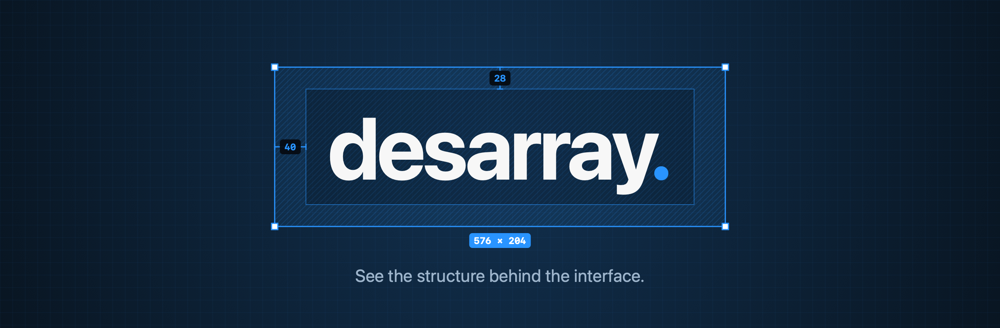
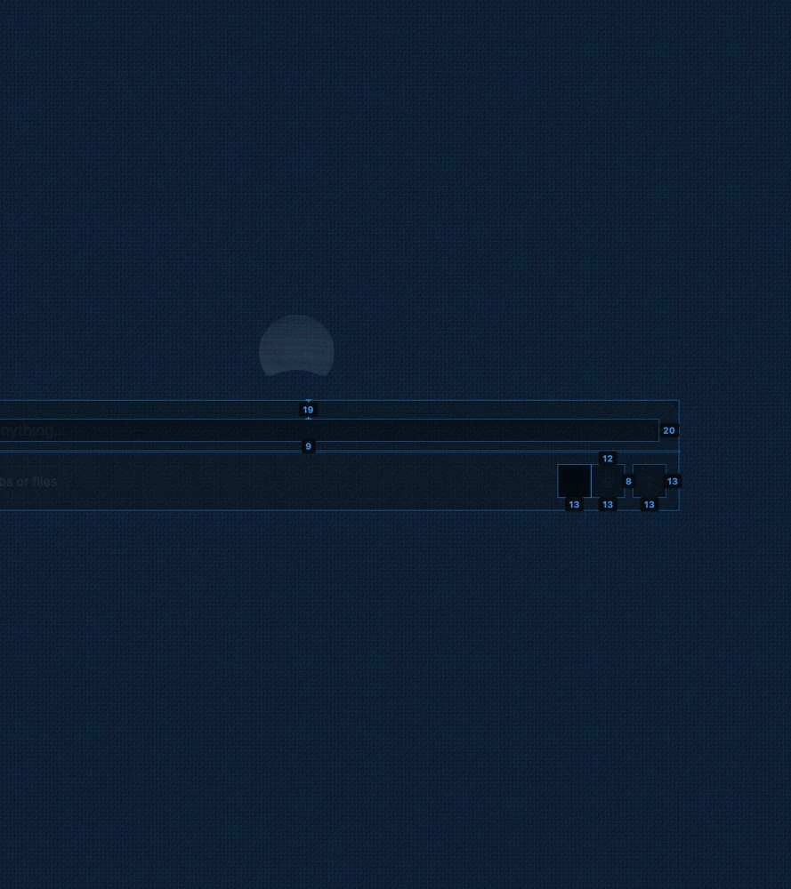

<p align="center">
  
</p>

<p align="center">
  <b>A native macOS x-ray for any interface.</b><br>
  Drag a frame over any app or website and watch it turn into a spec sheet: element boxes, spacing, insets and sizes, live.
</p>

<p align="center"><sub>Inspired by <a href="https://gridray.dev">Gridray</a> by <a href="https://x.com/svenma3">@svenma3</a>, reimagined as a native macOS app.</sub></p>

<p align="center">
  
  
  
  <a href="LICENSE"></a>
</p>

---

## desarray.

**desarray.** is a menu bar app for designers, design engineers and the curious. Hold it over any interface (a native Mac app, an Electron app, a web page in your browser) and it shows you how that interface is put together: which elements exist, how big they are, and how far apart they sit.

<p align="center">
  
</p>

<p align="center"><sub>A browser's new-tab search box under the x-ray: element boxes, insets (19, 20, 13) and an 8 pt gap between toolbar buttons.</sub></p>

## Why

The idea comes from **[Gridray](https://gridray.dev)** by **[@svenma3](https://x.com/svenma3)**, a Chrome extension that lets you drag a frame over a web page to see its spacing, sizes, radii and 4px grid. Gridray is great, but it lives inside one browser tab and reads the page's DOM. If you work on the web, go use it.

desarray. takes that idea and **repurposes it as a native macOS tool for designers**: it works across the *whole* screen, in any app that exposes an accessibility tree. Use it to:

- **study the interfaces you admire:** how much padding does that sidebar row really have?
- **QA what you (or your AI) just built** before you ship it, against the app you're imitating;
- **hand off evidence, not guesses:** export the measurements as JSON with their source attached.

## How it works

| Step | What you do | What desarray. does |
|---|---|---|
| **1. Activate** | Press <kbd>⌥</kbd><kbd>⇧</kbd><kbd>D</kbd> or use the menu bar icon | Dims the screen and waits for a frame |
| **2. Frame** | Drag over any UI | Reads the element tree under the frame through macOS Accessibility, and draws boxes, insets, gaps and size pills live (~8×/s) |
| **3. Focus** | Hover an element | Outlines it and labels *all* of its spacings |
| **4. Capture** | Press <kbd>⏎</kbd> or click **Capture** | Freezes the frame like ⌘⇧4: screenshot + full x-ray in a capture window with an element tree, details, and **Copy PNG / Save PNG / Copy JSON** |

### Shortcuts

| Key | Action |
|---|---|
| <kbd>⌥</kbd><kbd>⇧</kbd><kbd>D</kbd> | Start / stop inspecting |
| Drag · drag corners · drag inside | New frame · resize · move |
| <kbd>←</kbd><kbd>↑</kbd><kbd>→</kbd><kbd>↓</kbd> | Nudge 1 pt (<kbd>⇧</kbd> 10 pt, <kbd>⌥</kbd> resize) |
| <kbd>G</kbd> | Cycle grid: off · 4 pt · 4 px |
| <kbd>X</kbd> | Toggle the x-ray |
| <kbd>⏎</kbd> | Capture |
| <kbd>Esc</kbd> · <kbd>Esc</kbd> | Clear frame · exit |

## Evidence, not guesses

Pixels and accessibility frames can't tell you *why* a designer chose a value, so desarray. never pretends they can. Every value carries where it came from:

- **OBSERVED:** returned directly by a source: your frame, an Accessibility frame, a captured pixel.
- **INFERRED:** computed from observations. A gap between two frames is a *geometric gap*, not proof of a margin. A child's inset inside its parent is an *inset candidate*, not proof of padding.

The JSON export keeps that on every number (`evidence`, `method`, `limitation`), so the next person, or the next coding agent, knows what's fact and what's estimate.

## Install

```bash
brew install --cask atpugvaraa/atpugvaraa/desarray
```

Or grab `desarray-<version>.zip` from [Releases](https://github.com/atpugvaraa/desarray/releases), unzip, and drag **desarray.app** to Applications. Releases are signed with Developer ID and notarized by Apple.

## Build from source

Requires macOS 14+, Xcode 16+ (developed on Xcode 27) and [XcodeGen](https://github.com/yonaskolb/XcodeGen).

```bash
git clone https://github.com/atpugvaraa/desarray.git
cd desarray
xcodegen generate
xcodebuild -scheme desarray -derivedDataPath build build
open build/Build/Products/Debug/desarray.app
```

### Permissions

desarray. asks only when a feature needs it, and keeps working without it:

| Permission | Used for | Without it |
|---|---|---|
| **Accessibility** | Reading element frames for the x-ray | Frame + grid measurement still work |
| **Screen Recording** | The screenshot in a capture (desarray.'s own windows are excluded) | The capture window opens with the x-ray only |

> **Tip:** macOS ties these grants to the app's code signature. Builds are ad-hoc signed by default, which changes every build and silently drops the grants. Create `Config/Local.xcconfig` (git-ignored) with `CODE_SIGN_IDENTITY = Apple Development: Your Name (XXXXXXXXXX)` to keep them.

### Privacy

Nothing leaves your Mac. No network access, accounts or telemetry. Captures live in memory until you copy or save them. Text-field contents are never read.

## Architecture

```text
App/                       menu bar app, overlay panels, HUD, capture window (AppKit + SwiftUI)
Packages/DesarrayCore/
  DesarrayDomain           evidence & provenance models
  DesarrayGeometry         coordinate spaces, x-ray layout (insets, gaps, declutter), unit-tested
  DesarrayAccessibility    bounded AX tree snapshot of the window under the frame
  DesarrayCapture          one-shot ScreenCaptureKit capture, own windows excluded
  DesarrayRender           one CoreGraphics renderer for live overlay, capture window and PNG
  desarray-probe           dev CLI: run the whole pipeline on a screen rect
docs/DECISIONS.md          decision log, what's verified and what isn't
docs/RELEASING.md          tag → signed, notarized release + Homebrew cask bump
```

```bash
swift test --package-path Packages/DesarrayCore                     # unit tests
build/Build/Products/Debug/desarray.app/Contents/MacOS/desarray -selftest /tmp/out   # in-app self-test (Debug)
```

## Limitations (honest ones)

- **Only what Accessibility exposes.** Games, emulators, canvases and some custom-drawn views show up as one big box. A pixel-based fallback is on the roadmap.
- **Accessibility frames ≠ painted bounds.** Close in most apps, but not guaranteed.
- **Chromium / Electron apps** build their accessibility tree lazily; the first second over them can look sparse.
- **No corner radii, colours or typography yet.** Those need pixel analysis.
- Tested so far on a single Retina display. Multi-display setups are designed for but untested.

## Roadmap

- [x] Frame selection, 4 pt / 4 px grid, geometry in points
- [x] Live Accessibility x-ray with insets, gaps and sizes
- [x] Capture window with element tree and PNG / JSON export
- [x] Decluttering for dense lists and toolbars
- [ ] Pixel analysis: corner radius, colour, type size
- [ ] Browser companion for real DOM / computed CSS
- [ ] Compare two captures
- [ ] Design profiles: recurring spacing, colour and component candidates across screens

## Credits

- **Original idea: [Gridray](https://gridray.dev) by [@svenma3](https://x.com/svenma3).** Gridray x-rays web pages in Chrome; desarray. is an independent, unofficial macOS reimagining of that concept for designers. It is not affiliated with or endorsed by Gridray or its creator, and no Gridray code is used. All credit for the concept goes to them.
- Built by [Aarav Gupta](https://github.com/atpugvaraa).

## License

[MIT](LICENSE) © 2026 Aarav Gupta

<p align="center"><sub><b>desarray.</b> See the structure behind the interface.</sub></p>
